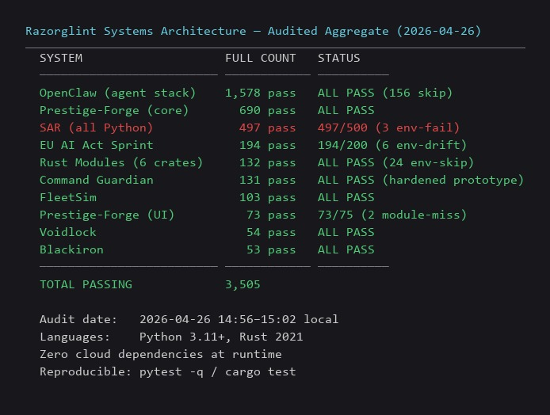
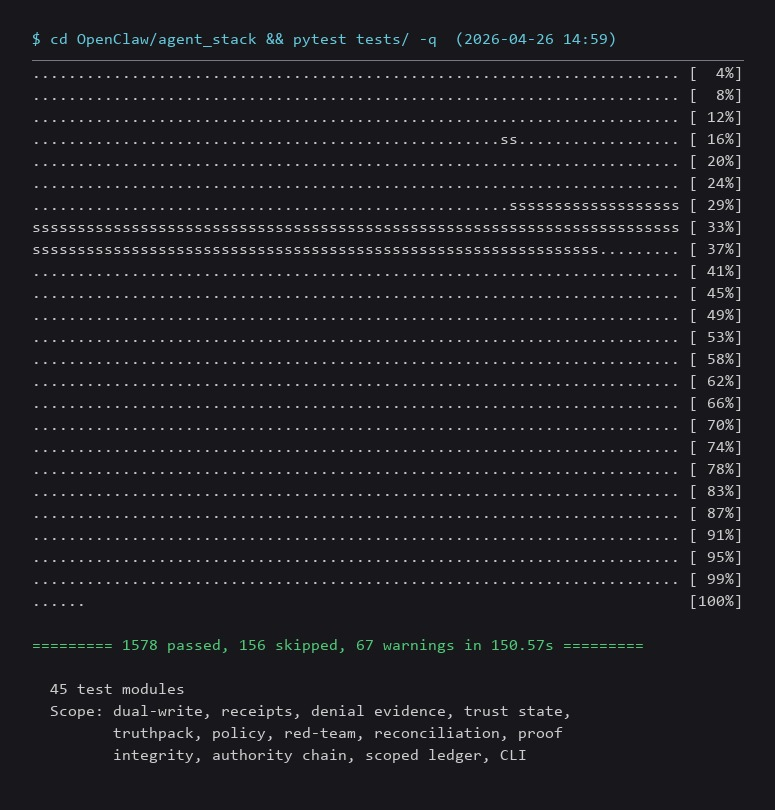
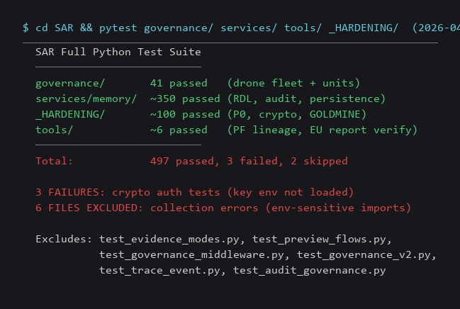
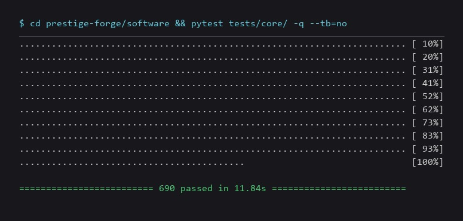
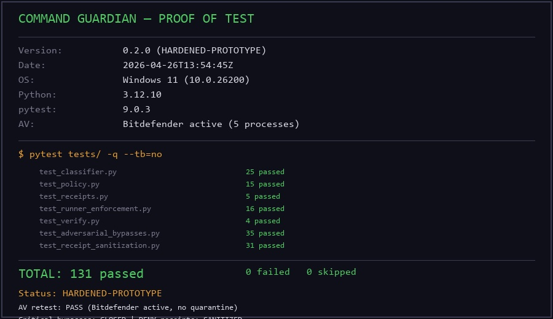
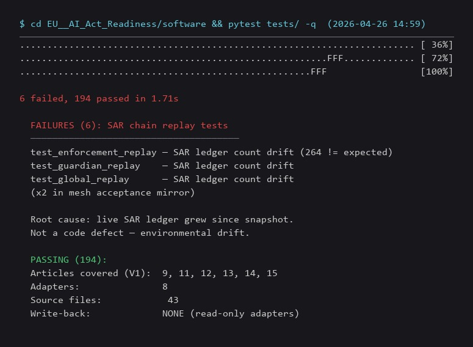
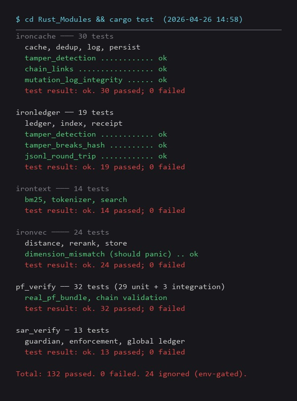
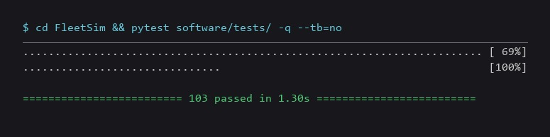
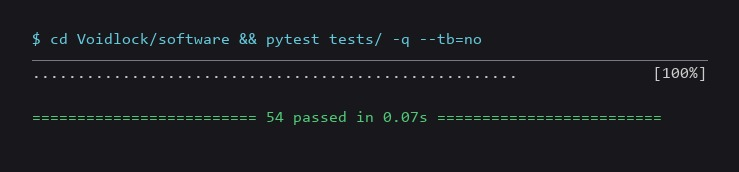
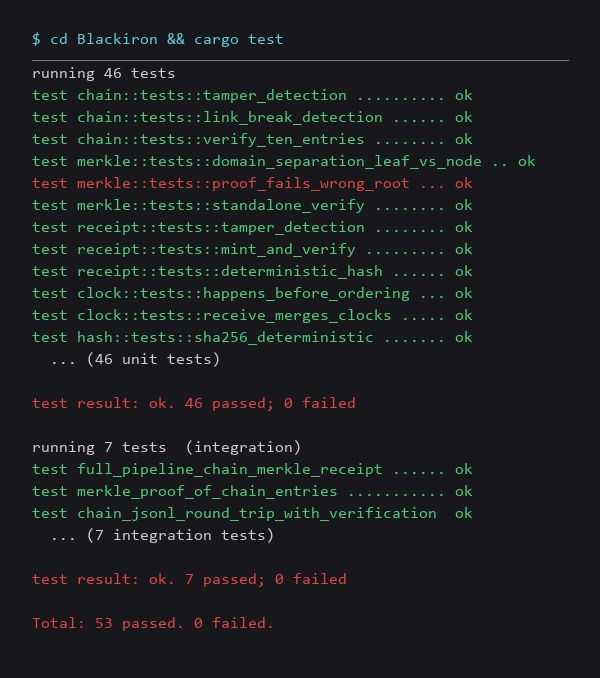

<h1 align="center">Razorglint Systems Architecture</h1>

<strong>Governed actions · Evidence continuity · Independent challenge · Verifiable handoff</strong>

<strong>15 selected systems · 3,505 historical passing test executions · Current October 2026 results</strong> 
3,505 is the dated 26 April 2026 audit, not a fresh October total or certification.

Badges identify technologies used by particular assets. They are not universal product, audit or deployment claims.

> **If a claim matters, bind it to evidence. If an action matters, record the authority. If proof is missing, expose that gap instead of inventing a PASS.**

**Reviewed 16 October 2026.** The architecture documents real engineering alongside historical proofs, prototypes, private development and candidate integrations. It is **not a unified public product**, an independent security certification or permission to use proprietary code.

**Explore:** [Evidence register](PUBLIC_EVIDENCE_REGISTER_2026-10-16.md) · [15 detailed system profiles](docs/SYSTEM_PROFILES_2026-10-16.md) · [Architecture boundaries](docs/ARCHITECTURE_LAYERS_2026-10-16.md) · [Verification playbook](docs/VERIFICATION_PLAYBOOK.md) · [IP and delivery boundaries](docs/IP_AND_DELIVERY_BOUNDARIES.md) · [Pain-to-Proof map](https://github.com/RazorglintLabs/razorglint-pain-to-proof-map) · [Damian Ketting portfolio](https://github.com/RazorglintLabs/damian-ketting-ai-systems-portfolio)

---

## The short version

An operationally serious system needs answers to **five practical questions**:

1. **Authority:** Who or what permitted the covered operation, under which explicit policy and scope?
2. **Observation:** What actually happened? Which evidence, identity and time context was recorded?
3. **Integrity:** Can someone reproduce the result or inspect its receipts and hashes?
4. **Continuity:** What changed over time, and what was missing or violated?
5. **Claim:** What does the result actually prove—and what must stay unsupported?

Razorglint Labs builds systems around **governance, evidence, verification, local-first operation, assurance, policy mapping and bounded AI workflows**. Each technology has its **own authority, source, maturity and license boundary**. Simply listing two components together never establishes integration, interoperability or production deployment.

### Proof at a glance

| Record | Observed/reported result | Limitation |
| --- | --- | --- |
| **Compliance Drift Detector — 16 Oct 2026** | **76 passing tests**, source-bound Windows/Linux CI; unsigned Windows x64 **v0.2 controlled-evaluation preview** owner-accepted | [Exact release record](https://github.com/RazorglintLabs/ComplianceDriftDetector/blob/main/docs/RELEASE_STATUS.md); not enterprise GA, independently audited or digitally publisher-signed |
| **Historical portfolio audit — 26 Apr 2026** | **3,505 executed passing tests** across 10 audited rows | Some environmental failures/skips; not rerun as one suite, not October and not externally certified |
| **Prestige-Reforged — Oct 2026** | Private staged source/phase qualification; verification, history, claims and handoff work | Windows search, UX and installer/customer acceptance remain in review; legacy Prestige-Forge counts are not current Reforged counts |
| **Viventia + VEAC** | Private scoped evidence cockpit and separate adversarial-assurance development | No current global SAFE certificate, production SIEM/EDR equivalent or service-scale guarantee |
| **Governed AI Control & Assurance Stack** | Candidate integration architecture and Phase 0 source/IP admission process | Not a completed, joined six-component buyer release |

**Do not add April and October results into a new grand total.** They use different dates, test populations, source states, environments and product identities.

[Historical audit](assets/proof/PROOF_AUDIT_2026-04-26.md) · [Proof manifest](assets/proof/PROOF_MANIFEST.md) · [Current evidence register](PUBLIC_EVIDENCE_REGISTER_2026-10-16.md).

---

## Reference architecture

**Conceptual responsibilities—not proof that all these components are already connected.**

\`\`\`text
                      HUMAN / EXPLICIT AUTHORITY
                                 |
                    permitted purpose + scope
                                 v
                   +----------------------------+
                   | POLICY / GOVERNANCE        |
                   | SAR · policy engines       |
                   | allow / deny / unresolved  |
                   +----------------------------+
                                 |
                      covered permitted operation
                                 v
                   +----------------------------+
                   | EXECUTION / OBSERVATION    |
                   | tools · agent mechanisms   |
                   | fleet simulation · apps    |
                   +----------------------------+
                                 |
                        scoped records / events
                                 v
                   +----------------------------+
                   | EVIDENCE / PROVENANCE      |
                   | hashes · receipts · time   |
                   | custody and lineage        |
                   +----------------------------+
                                 |
                                 v
                   +----------------------------+
                   | EVALUATION / VERIFICATION  |
                   | Prestige-Reforged · CDD    |
                   | bounded findings + gaps    |
                   +----------------------------+
                                 |
                      separate adversarial challenge
                                 v
                   +----------------------------+
                   | EXTERNAL EXAMINER / HUMAN  |
                   | VEAC · buyer · operator    |
                   | accepts / challenges claim |
                   +----------------------------+
\`\`\`

**Authority flows from an explicit owner or policy boundary. Evidence flows out from the covered operation.** A verifier is not an authority issuer. A product cannot certify itself. A digest is not source authenticity, a history trace is not completeness, and a simulated fleet is not a fielded fleet.

### Architecture layers

| Layer | Job | Examples |
| --- | --- | --- |
| **Authority & governance** | Determine permissions and named policy verdicts | SAR, PolicySourceEngine, VerdictGate |
| **Bounded operation** | Carry out or simulate explicitly covered actions | OpenClaw, Voidlock, Command Guardian, FleetSim |
| **Integrity & history** | Preserve inspectable receipts, chronology and chains where implemented | Blackiron, ProofChain, SealVault, Phantom Ledger |
| **Evidence evaluation** | Bind checks, gaps, history, recovery and claims to declared input | Prestige-Reforged, CDD, Trust Continuity Mapper |
| **Operator presentation** | Make scoped records understandable without inventing authority | Viventia, CTLM/LocalChad, Decision Provenance Tracker |
| **Independent challenge** | Probe assertions with separate tests, hostile cases and scope | VEAC, product/receiver qualification gates |

[Detailed authority walls and GCA candidate integration](docs/ARCHITECTURE_LAYERS_2026-10-16.md).

---

## Fifteen selected systems

These are **15 editorially selected profiles for the October architecture**, not a statement that exactly 15 products are available, independently deployed or currently tested. The historical April “15 systems” inventory must not be confused with this updated cross-section.

| # | System | Main capability | Current evidence boundary |
| ---: | --- | --- | --- |
| 01 | **Prestige-Reforged** | Evidence and source admission, claims, history/drift, proof handoff | Private staged qualification; customer Windows product work not accepted as final |
| 02 | **SAR** | Policy authority, fail-closed governance and receipts | Historical tests, private source; not a universal integration claim |
| 03 | **Viventia** | Scoped customer / incident-response evidence cockpit | Private V1 work; not SIEM, EDR or hosted multi-tenancy |
| 04 | **VEAC** | Independent adversarial target challenge | Campaign-scoped results; no general certification |
| 05 | **[Compliance Drift Detector](https://github.com/RazorglintLabs/ComplianceDriftDetector)** | Structured policy/evidence checkpoint drift | **Current Oct 16 CI; unsigned Windows preview** |
| 06 | **OpenClaw** | Governed agent/action mechanism | Historical 1,578 passes; source/IP admission still required |
| 07 | **Voidlock** | Deny-first capabilities and monotonic execution budgets | Historical/local; not a certified OS sandbox |
| 08 | **Blackiron** | Rust integrity, Merkle, clock and receipt primitives | Historical/local 53-test record |
| 09 | **ProofChain** | Hash-linked append-only history, accumulators | Historical/local; current source/transfer audit needed |
| 10 | **SealVault** | Evidence sealing, Merkle inclusion and optional signatures | Historical/local; validate supported routes and ownership |
| 11 | **Command Guardian** | Terminal safety policy and audit chain | 131 historical passes; prototype, not signed receipts or SAR-linked |
| 12 | **FleetSim** | Simulation-grade fleet-node trust transitions | 103 historical passes; no field safety proof |
| 13 | **EU AI Act Evidence Readiness Sprint** | Read-only evidence mapping for six articles | Historical scoped tests; no legal/regulatory compliance verdict |
| 14 | **ReasonForge** | LLM data quality, leakage and evaluation patterns | Separate source/product documentation, current proof per repo |
| 15 | **CalledIt** | Sealed predictions, React PWA and native app wrappers | Private product source; no verified revenue/usage claims here |

Read [full system profiles](docs/SYSTEM_PROFILES_2026-10-16.md) for mechanics, source boundaries, maturity and non-claims.

**Additional technology and project families** include CTLM/LocalChad, ChessClock, Isengard, VerdictGate, PolicySourceEngine, Phantom Ledger, Trust Continuity Mapper, Decision Provenance Tracker, ForgeCell, Rust Modules, Truthpacks, BountyPipeline and the Developer Supply-Chain Exposure Proof Kit. **GCA Stack** is an integration/acquisition-package candidate, not a sixteenth ready-made product. The larger estate is intentionally not restricted to fifteen names.

---

## Selected systems: what the engineering does

### Prestige-Reforged — Evidence, evaluation and claim validity

**What problem:** Teams need to know whether a claim still corresponds to exact evidence and a reproducible source state rather than a stale screenshot or a vague “PASS.”

**Engineering trajectory:** staged Python local-first core; explicit source identity and grant boundaries; evidence custody; verification profile; immutable Claims/Evaluations; structured WHY; historical drift; proof handoff and claim-preflight. Separate human-first UI work aims to make those concepts usable without erasing unknown states.

**2026 status:** Source and phase qualifications exist privately, but current Windows search and installer work still has unresolved UI/integration gates. **April Prestige-Forge 690-core/73-UI figures belong to the legacy code line, not automatically to Reforged.** [Detailed profile](docs/SYSTEM_PROFILES_2026-10-16.md#01--prestige-reforged).

### SAR — External policy authority

**What problem:** A system that acts should not simply authorize itself because an AI model recommended a step.

**Mechanisms:** explicit governance boundaries, deterministic policy enforcement, documented signed/linked receipts in covered implementations, protected mutation and a separation between policy authority and the executor. Historical April source tests reported **497 Python passes plus 3 environment failures**. **Do not infer SAR integration** with every named executor or call it a deployed enterprise control plane.

### Viventia — Scoped operational evidence

**What problem:** Investigators and customers need a comprehensible, scoped evidence trail without mixing customer identities or inventing incident authorization.

**Mechanisms:** local-first evidence identity; explicit customer/deployment scoping; intended Customer and IR/MSSP cockpit projections; repeatable isolated profile qualification. Current private V1 product work remains bounded. **No agents in V1.0, no SIEM/EDR claim, no unrestricted live alerting or production SaaS scale implied.**

### VEAC — The examiner is not the product

**What problem:** A product's happy-path tests are insufficient to establish all security-relevant behaviors.

**Mechanisms:** independent repository and authority; retained hostile scars; campaign-scoped rules/probes; target identity and known-bad fixtures. Results such as RED, INSUFFICIENT, WATCH and CLEAR have defined examination scopes. **CLEAR is not a safety certificate.**

### Compliance Drift Detector — A current public technical preview

**What problem:** A structured policy can look healthy now while the supplied evidence history shows an earlier failure.

**Mechanisms:** accepts **operator-supplied structured** policy claims and **operator-preclassified dated observations**; computes ALIGNED, DRIFTING, VIOLATED and UNDECLARED; exposes recovered history, missing mappings, separate unmatched behavior findings, JSON/HTML/Markdown reports and v2 JSON consistency verification.

**Current result:** [76 regression tests passed](https://github.com/RazorglintLabs/ComplianceDriftDetector/blob/main/docs/RELEASE_STATUS.md) in the 16 Oct Windows/Linux Python 3.11/3.12 qualification. Owner accepted **unsigned Windows x64 v0.2 controlled evaluation** at qualified source commit \`662f84caa2ed372abde6a83245c58b466e52ce94\`.

**Not claimed:** freeform log/PDF analysis, continuous monitoring, authenticated source truth, digitally signed publisher identity, enterprise distribution, certification or automatic legal compliance.

### OpenClaw & Voidlock — Governed action and bounded execution

**OpenClaw** historically demonstrated dual-write/denial/truthpack agent test families (**1,578 passes, 156 skips** in April). **Voidlock** historically demonstrated deny-by-default capability attenuation, monotonic budgets and bounded judge behavior (**54 passes**). Both need current source/IP and adversarial requalification before integration admission. A diagram does not prove all agent actions are governed or that a sandbox cannot be escaped.

### Blackiron, ProofChain & SealVault — Integrity primitives, not magical truth

**Blackiron:** hash-chain, domain-separated Merkle, clock and receipt concepts in Rust; **53 historical passes**.  
**ProofChain:** hash-linked append-only history, query/export and accumulator design in local source.  
**SealVault:** local hash modes, batch inclusion, optional signatures and offline verification in historical source.

These are **distinct technology assets**, not a merged “tamper-proof ledger.” Integrity checks detect covered alterations; they do not validate source authenticity without separate mechanisms.

### Command Guardian — A seatbelt for the terminal

**Mechanisms:** deny-first CLI command classification, risky-action authorization, SHA-256 chain receipts, sanitized denied-command storage and bounded adversarial regression tests. **131/131 historical passing tests** after hardening. **Not production-ready; not SAR-integrated; receipt signing is deferred.** Existing MIT rights must be considered in any sale/exclusivity analysis.

### FleetSim — Trust-plane simulation

**Mechanisms:** heartbeat/distress transitions, severity ladder, reflex/transition records and degraded-state logic. The April audit reported **103 passes**. This is **simulation-grade engineering**, not proof about physical vehicles, aircraft or certified safety.

### EU AI Act Evidence Readiness Sprint — Gaps, not legal verdicts

**Mechanisms:** read-only adapters, article-to-evidence mapping, gap registers, oversight and reporting for six selected articles (9, 11, 12, 13, 14, 15). April reported **194 passes with six environment-sensitive caveats**. It does **not** certify compliance with the Act or replace legal/conformity assessment.

### ReasonForge — LLM dataset integrity workflows

**Mechanisms:** structured schema validation, duplication and potential leakage detection, evaluation pipelines and reporting designed to reduce avoidable dataset issues. Current standalone release and buyer-readiness depend on its own source and test state; no guaranteed downstream model quality is claimed.

### CalledIt — Prediction sealing and app delivery

**Mechanisms:** FastAPI + SQLite, AES-256-GCM sealed records, anonymous device-auth design, React/TypeScript PWA, Android Capacitor and Windows Tauri wrappers. Source and test maturity must be evaluated against an exact release. There is no verified customer traction or externally proven anti-cheating guarantee in this public architecture audit.

---

## Design law — specified boundary, not universal guarantee

| Principle | What it means in covered implementations | What it does not mean |
| --- | --- | --- |
| **Authority separated from execution** | A policy evaluator governs the defined operation instead of accepting arbitrary AI output as permission | Every portfolio app is already SAR-integrated |
| **Deny-first where implemented** | Invalid/unsupported policy states cause a defined refusal | No adversary can ever bypass any component |
| **Determinism** | Repeatable evaluation of specific inputs/contracts | Every AI output or real-world event is deterministic |
| **Receipts / integrity** | Hashes, chains and digital signatures in the systems that actually implement them | All receipts everywhere are signed or input assertions true |
| **Independent challenge** | Examiner uses its own propositions/hostile fixtures and exact target identity | Examiner certifies overall product security |
| **Local-first operation** | Operator-controlled data and offline paths wherever qualified | No external API, dependency, model download or network interaction exists anywhere |
| **No silent component admission** | Source, licensing, tests, ownership and integration contracts must be reviewed | Shared interfaces or joined product already exist |
| **Non-claims are mandatory** | Scope, missing inputs, weaknesses and uncertainty remain visible | Passing internal tests is an external audit |

---

## Technology stack — selected surfaces

| Layer | Representative technology | Qualifier |
| --- | --- | --- |
| Languages | Python 3.11+, Rust 2021, TypeScript, PowerShell/Bash | Varies by project |
| APIs and apps | FastAPI, React, Electron, WPF/.NET design, Tkinter, Capacitor, Tauri | Different codebases and stages |
| Cryptographic mechanisms | SHA-256, hash chains, Merkle proofs, Ed25519 and AES-256-GCM | Not implemented uniformly; different trust properties |
| Evidence and storage | File-backed bundles, SQLite, JSON/JSONL and receipts | Scope and retention by product |
| AI/data workflows | Structured evaluation, vector retrieval and data-quality checks | Some depend on optional external services/models |
| Qualification | pytest, unittest, cargo test, Windows/Linux GitHub Actions and hostile fixtures | Test results only valid for recorded commits/environments |

---

## Historical passing test audit — 26 April 2026

The source [PROOF_AUDIT_2026-04-26.md](assets/proof/PROOF_AUDIT_2026-04-26.md) recorded these **passing executions**, and explicitly noted environment failures/skips. Do not silently treat this as a current all-systems qualification:

| Historical suite | Passes | Recorded limits |
| --- | ---: | --- |
| OpenClaw | 1,578 | 156 skipped |
| Legacy Prestige-Forge core | 690 | Not current Prestige-Reforged |
| SAR Python | 497 | 3 env-gated failures |
| EU AI Act Sprint | 194 | 6 environment-drift issues |
| Rust Modules (6 crates) | 132 | 24 env-skips |
| Command Guardian | 131 | Hardened prototype; no receipt signing |
| FleetSim | 103 | Simulation only |
| Legacy Prestige-Forge UI | 73 | 2 module-missing tests |
| Voidlock | 54 | Historical local run |
| Blackiron | 53 | Historical local run |
| **Historical recorded sum** | **3,505** | **Not an independently certified or October-comparable total** |

### Historical proof gallery (preserved unchanged)

Expand the original April 2026 screenshots

The [historical proof manifest](assets/proof/PROOF_MANIFEST.md) records what selected screenshots establish and what they **do not** establish. Screenshots alone do not offer current code execution, independent attestation or cryptographic customer assurance.

---

## Verify a current public system

There is no legitimate one-command procedure to clone fifteen **private** systems and reproduce a historical multi-repo sum.

For an actually public code path, start with [Compliance Drift Detector](https://github.com/RazorglintLabs/ComplianceDriftDetector):

1. Identify source commit \`662f84caa2ed372abde6a83245c58b466e52ce94\` and consult the [release-status receipt](https://github.com/RazorglintLabs/ComplianceDriftDetector/blob/main/docs/RELEASE_STATUS.md).
2. Inspect the [documented self-service quickstart](https://github.com/RazorglintLabs/ComplianceDriftDetector/blob/main/SELF_SERVICE_QUICKSTART.md) and current license/claim boundaries.
3. Check [Windows build Actions 38893213993](https://github.com/RazorglintLabs/ComplianceDriftDetector/actions/runs/38893213993) and [cross-platform test Actions 38893214199](https://github.com/RazorglintLabs/ComplianceDriftDetector/actions/runs/38893214199) against that **same** commit.
4. Reproduce supported example/verification commands in a matching environment. Record PASS, FAIL, SKIP and any changed source identity.
5. Treat the unsigned Windows preview as **controlled evaluation only**, and separate report hash consistency from signatures or source authenticity.

[Complete reproducibility / claim-checking playbook](docs/VERIFICATION_PLAYBOOK.md).

---

## Commercial, integration and IP boundaries

- **Prestige-Reforged core IP is retained** by Razorglint. A separately negotiated bounded license, OEM use or adapter is not a transfer of core ownership.
- **CDD**, Viventia, SAR/automation technology and other assets each have their own evaluation, product, ownership and dependency boundaries; a public repository is not a blanket redistribution license.
- The **Governed AI Control & Assurance Stack** is a proposed coherent strategic package under **Phase 0 admission**, not a finished integrated runtime; independent VEAC authority must remain distinct.
- The April source audit is **not evidence of market valuation, revenue, customers, certified security, clean transfer rights or current product quality**.
- Buyer diligence requires exact source identities, dependency and IP inventories, reproducible tests, claim/non-claim sheets, transfer scope and bounded support terms.

[Product and IP boundaries](docs/IP_AND_DELIVERY_BOUNDARIES.md) · [Pain-to-Proof business problem guide](https://github.com/RazorglintLabs/razorglint-pain-to-proof-map).

---

## About Razorglint Labs

**Razorglint Labs / TCOG Collective LLC** develops evidence-first engineering tools, governance boundaries, human-facing product surfaces and inspectable automation.

**Damian G. L. Ketting** — Founder / systems builder  
**Contact:** [razorglint.ops@protonmail.com](mailto:razorglint.ops@protonmail.com)  
**Portfolio:** [Damian Ketting — Systems](https://github.com/RazorglintLabs/damian-ketting-ai-systems-portfolio)

© 2026 Razorglint Labs / TCOG Collective LLC · Individual repository licenses and negotiated agreements govern use.

